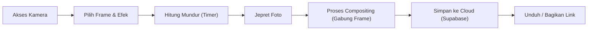

<p align="center">
  
</p>

<h1 align="center">RIRI PHOTOBOOTH</h1>

<p align="center">
  Web photobooth digital interaktif dengan efek kamera real-time, kustomisasi bingkai, dan integrasi penyimpanan cloud (Supabase).
</p>

<p align="center">
  
  
  
  
  
</p>

---

## Overview

RIRI PHOTOBOOTH adalah aplikasi full-stack untuk memberikan pengalaman photobooth digital yang nyata langsung melalui browser. Frontend dibuat dengan Next.js + React, backend memakai Express + Prisma, dan database serta penyimpanan file menggunakan PostgreSQL/Supabase.

Fokus project ini adalah membuat proses pengambilan foto yang mulus: kamera beroperasi seperti cermin (mirror) mirip antarmuka iPhone, pengguna bisa memilih berbagai macam bingkai, memberikan efek filter visual, dan kemudian foto disimpan ke cloud serta dapat diunduh langsung.

## Fitur

| Modul | Fitur |
| --- | --- |
| Kamera | antarmuka bergaya iPhone, fitur cermin otomatis, filter gambar |
| Bingkai | kustomisasi frame transparan otomatis, pemosisian wajah cerdas |
| Export | unduh foto satuan resolusi tinggi, bagikan tautan, mode cetak |
| Proteksi | anti-spam klik ganda (debounce), JWT Access Token |
| Penyimpanan | unggah otomatis ke Supabase Storage, privasi aman |
| Backend | REST API modular, Prisma ORM, arsitektur Vercel Serverless |

## Alur Aplikasi



## Tech Stack

| Layer | Teknologi |
| --- | --- |
| Frontend | Next.js 14, React 18, React Webcam, Zustand |
| Styling | Tailwind CSS, CSS Filters, Lucide / Material Icons |
| Backend | Node.js, Express, Prisma Client, Vercel Serverless |
| Database | PostgreSQL (Supabase) |
| Cloud Storage | Supabase Storage (Private Buckets) |
| Integrasi | CORS, Multer, Supabase JS SDK |

## Struktur Folder

```text
RIRI/
|-- backend/
|   |-- prisma/
|   |   `-- schema.prisma
|   |-- src/
|   |   |-- controllers/
|   |   |-- routes/
|   |   |-- services/
|   |   |-- lib/
|   |   `-- app.js
|   `-- vercel.json
|
|-- frontend/
|   |-- src/
|   |   |-- app/
|   |   |-- components/
|   |   |-- hooks/
|   |   |-- store/
|   |   `-- lib/
|   `-- public/
```

## Instalasi Lokal

```bash
# 1. Kloning repository
git clone https://github.com/tegokkk/RIRI.git

# 2. Setup Backend
cd RIRI/backend
npm install
# Buat file .env dan isi dengan DATABASE_URL dari Supabase (Gunakan port 5432)
npx prisma migrate dev
npm run dev

# 3. Setup Frontend
cd ../frontend
npm install
# Buat file .env dan isi NEXT_PUBLIC_API_URL=http://localhost:5000
npm run dev
```
